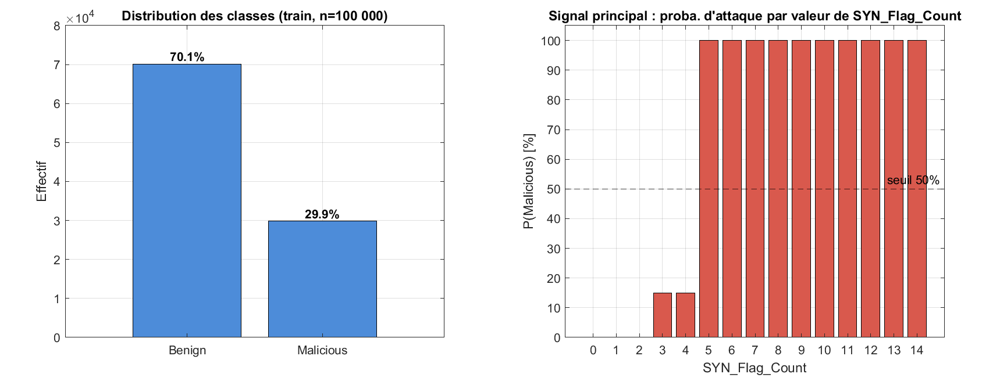
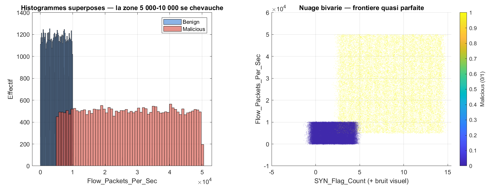
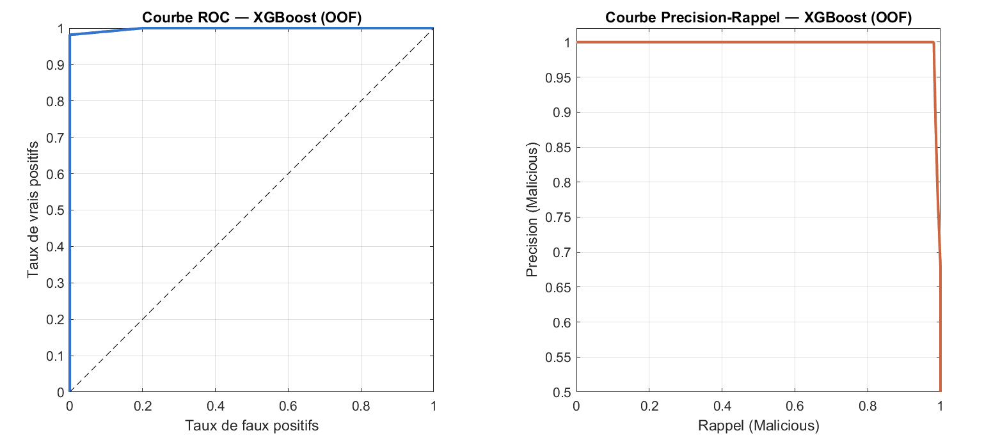
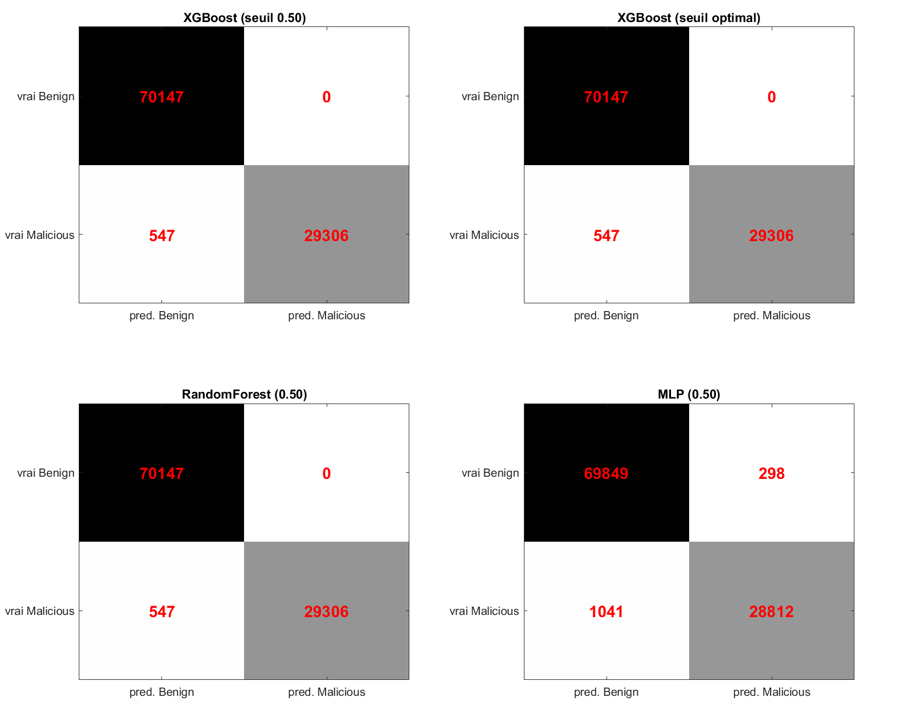
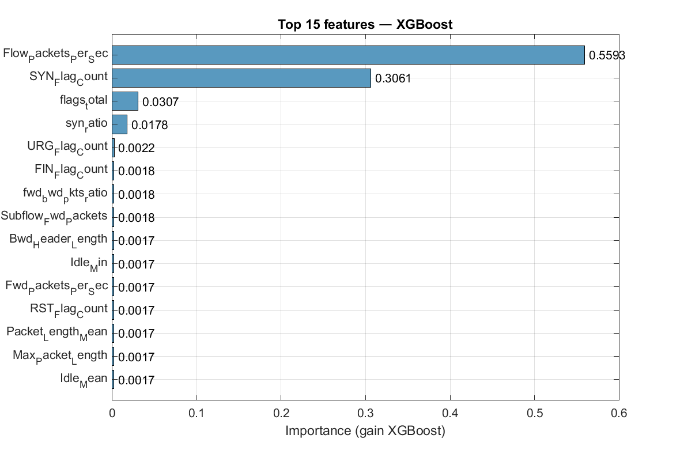
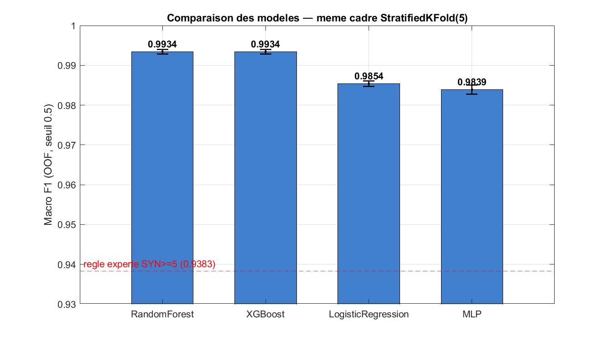
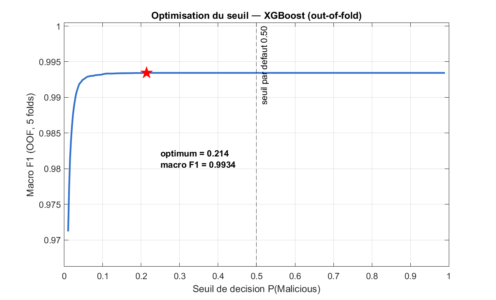
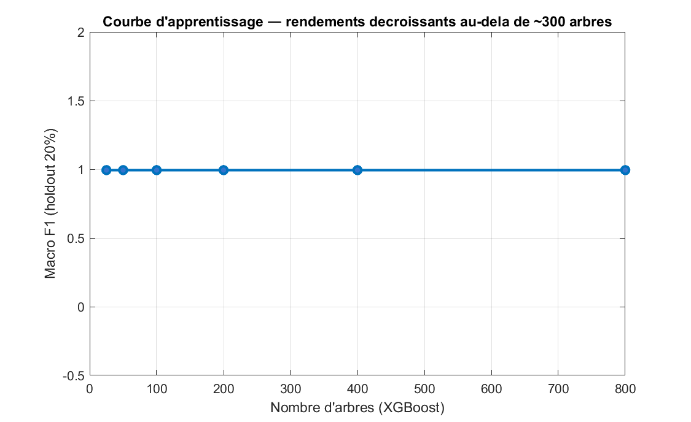
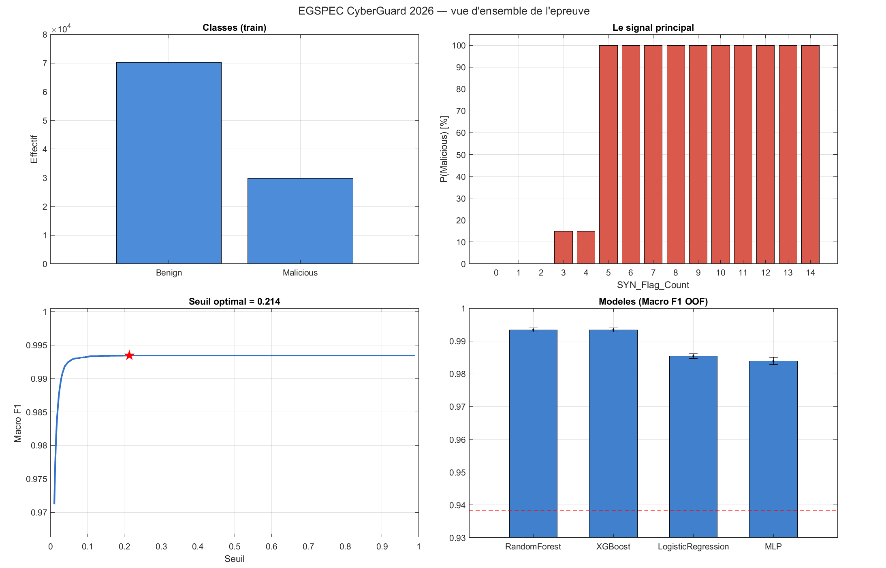

# 🛡️ KAGGLE-CYBERGUARD-2026

**Auteur : [Jimmy SAMBIN](https://github.com/jimmy-sambin)** · RSI — Cybersécurité · Infrastructure · IA appliquée

[](https://www.python.org/)
[](#-mod%C3%A9lisation)
[](https://www.kaggle.com/competitions/egspec-cyberguard-codeforgeclub-csbs-2026)
[](#-r%C3%A9sultats)
[](#-donn%C3%A9es)

> **AI-Powered Network Intrusion Detection Challenge** — *Detect. Classify. Defend.*

Solution individuelle au hackathon Kaggle **EGSPEC CYBERGUARD CODEFORGECLUB CSBS 2026** (E.G.S Pillay Engineering College, Inde — 26 septembre 2026) : détection d'intrusions réseau par Machine Learning sur des statistiques de flux façon CIC-IDS.

Au-delà du score (**Macro F1 OOF = 0,9934**), ce projet est un cas d'école de **pensée critique appliquée aux données** : l'annonce officielle décrivait un problème qui n'existait pas dans les données — et le jeu de test lui-même était piégé.

---

## 📑 Sommaire

1. [Annonce officielle vs données réelles](#-annonce-officielle-vs-données-réelles)
2. [Le générateur, parfaitement identifiable](#-le-générateur-parfaitement-identifiable)
3. [Anomalie majeure : un test 100 % bénin](#-anomalie-majeure--un-test-100--bénin)
4. [Méthode](#-méthode)
5. [Résultats](#-résultats)
6. [Comparaison de modèles et seuillage](#-comparaison-de-modèles-et-seuillage)
7. [Enseignements](#-enseignements)
8. [Structure du dépôt](#-structure-du-dépôt)
9. [Reproduction](#-reproduction)
10. [Technologies](#-technologies)

---

## ⚖️ Annonce officielle vs données réelles

| Élément | Annonce officielle | Données réelles |
|---|---|---|
| Cible | 7 classes (`Normal`, `DoS`, `Probe`, `Brute_Force`, `Web_Attack`, `Botnet`, `Other`) | **2 classes** : `Benign` (70,1 %) / `Malicious` (29,9 %) |
| Métrique | Macro F1 sur 7 classes | Macro F1 binaire (vraisemblablement) |
| Valeurs manquantes | « some features may contain missing values » | **Aucune** |
| Catégorielles haute cardinalité | « challenge to solve » | **1 seule** : `Protocol` (TCP/UDP/ICMP) |
| Déséquilibre | « extreme imbalance » | Modéré : 70/30 |

**10 minutes d'EDA ont suffi** à révéler que l'énoncé ne décrivait pas le dataset — et cela a dicté toute la stratégie.



## 🔍 Le générateur, parfaitement identifiable

Deux variables portent tout le signal — le reste du dataset est du « bruit décoratif » (corrélations ≈ 0,005 avec la cible) :

| Zone | P(Malicious) |
|---|---|
| `SYN_Flag_Count ≤ 2` | **0 %** (42 029 lignes, toutes bénignes) |
| `SYN_Flag_Count ≥ 5` | **100 %** (~24 947 lignes, toutes malicieuses) |
| `SYN ∈ {3, 4}` & `Flow_Packets_Per_Sec > 5000` | **≈ 26 %** (zone ambiguë) |

Corrélations cible : `SYN_Flag_Count` **0,80** · `Flow_Packets_Per_Sec` **0,81**.



## 🕵️ Anomalie majeure : un test 100 % bénin

Le modèle, valide en OOF (0,9934), prédit **0 ligne malicieuse sur 25 000** dans le jeu de test — probabilité max 0,15, moyenne ≈ 0,003. L'analyse des distributions explique pourquoi :

- `SYN_Flag_Count` du test ne prend **que les valeurs 0–4** (jamais ≥ 5)
- `Flow_Packets_Per_Sec` du test : max ≈ 9 999 (plage bénigne)
- Les features de la zone ambiguë sont quasi identiques entre train et test (pas de drift détectable)

**Conclusion (inférence forte)** : le jeu de test a été généré uniquement à partir de la distribution bénigne. Vérifier la distribution des features du test **avant** de finaliser des prédictions : leçon retenu pour tous les datasets synthétiques.

## ⚙️ Méthode

1. **Feature engineering réseau** : `bytes_per_packet`, ratios fwd/bwd, `syn_ratio`, `rst_ratio`, `flags_total`, `active_idle_ratio`, `iat_std_ratio`, port well-known, one-hot `Protocol`.
2. **Validation** : StratifiedKFold(5), seed 42 — scores par fold : 0,9930 / 0,9929 / 0,9933 / 0,9944 / 0,9936.
3. **Modèle** : XGBoost (`n_estimators=400`, `max_depth=8`, `lr=0.08`, `scale_pos_weight≈2.35`, hist).
4. **Référence « règle experte »** : `SYN ≥ 5 → Malicious` seul atteint déjà **Macro F1 = 0,9383**.

## 🏆 Résultats

**OOF — 100 000 lignes** :

| | Précision | Rappel | F1 |
|---|---|---|---|
| Benign | 0,9923 | 1,0000 | 0,9961 |
| Malicious | 1,0000 | 0,9817 | 0,9908 |
| **Macro F1** | | | **0,9934** |

Matrice de confusion : **70 147 vrais bénins, 0 faux positifs, 547 malicieux ratés** — tous dans la zone ambiguë `SYN ∈ {3,4}`, où le générateur les rend indiscernables des bénins (erreur quasi irréductible).

| Courbes ROC & PR | Matrices de confusion (4 modèles) |
|:---:|:---:|
|  |  |

Top features (gain) : `Flow_Packets_Per_Sec` 0,56 · `SYN_Flag_Count` 0,31 · `flags_total` 0,03 · `syn_ratio` 0,02.



## 📊 Comparaison de modèles et seuillage

Même cadre pour tous : StratifiedKFold(5), seed 42, mêmes features.

| Modèle | Macro F1 OOF (seuil 0,5) | Seuil optimal | Macro F1 optimal |
|---|---|---|---|
| Régression logistique | 0,9854 | 0,617 | 0,9885 |
| RandomForest (100 arbres) | 0,9934 | 0,348 | 0,9934 |
| **XGBoost** | **0,9934** | 0,214 | **0,9934** |
| MLP (64,32) | 0,9839 | 0,585 | 0,9843 |
| Règle experte `SYN ≥ 5` (référence) | 0,9383 | — | — |





**Enseignements du seuillage** : pour XGBoost et RF, la courbe seuil → F1 est un *plateau* — les 547 faux négatifs sont statistiquement indiscernables. Le seuillage rapporte +0,3 pt à la régression logistique et +0,04 pt au MLP. **Courbe d'apprentissage** : Macro F1 = 0,9939 dès **25 arbres** — le signal est trivial, toute complexité supplémentaire n'apporte rien.



## 🎓 Enseignements

1. **Toujours valider l'annonce contre les données** : 10 minutes d'EDA ont révélé que l'énoncé ne décrivait pas le dataset réel.
2. **Chercher d'abord la frontière de décision** : 2 features suffisaient ici ; un modèle complexe n'améliore que les 547 cas ambigus, pas la stratégie.
3. **Le holdout local est le seul juge fiable** — surtout quand la distribution du test diverge.
4. **Un test sans cas positifs est un piège classique** des datasets synthétiques : vérifier les features prédictives du test avant de finaliser.
5. Les datasets « CIC-IDS-like » régénérés aléatoirement perdent la structure réelle du trafic (les corrélations réseau authentiques ont disparu sauf pour 2 features).

## 📁 Structure du dépôt

```
KAGGLE-CYBERGUARD-2026/
├── README.md
├── .gitignore
├── notebook_pedagogique.ipynb     # Notebook pédagogique complet (10 sections)
├── graphiques/                    # 9 figures MATLAB (dashboard, ROC/PR, confusion…)
├── data/
│   ├── TRAIN_DATA.csv             # 100 000 lignes × 50 colonnes (features + Attack_Label)
│   ├── TEST_DATA.csv              # 25 000 lignes × 49 colonnes
│   ├── SAMPLE_DATA.csv            # Échantillon du test (50 lignes)
│   ├── submission.csv             # Prédictions finales (25 000 lignes)
│   ├── description_dataset.txt    # Description des 49 features + cible
│   └── matlab/                    # 14 CSV intermédiaires (scores, ROC, confusions…)
└── rapports/
    ├── rapport.md                 # Analyse complète (annonce vs réalité, anomalies, leçons)
    └── sujet-du-concours.md       # Compréhension de l'énoncé officiel
```

_Les scripts d'entraînement (Python) et de visualisation (MATLAB) restent locaux et ne sont pas publiés dans ce dépôt (voir `.gitignore`)._

## 🔁 Reproductibilité

Le pipeline est entièrement reproductible à partir des éléments publiés :

1. **Données** : `data/TRAIN_DATA.csv` + `TEST_DATA.csv` (téléchargeables aussi via l'API Kaggle)
2. **Features** : ingénierie documentée dans [`rapports/rapport.md`](rapports/rapport.md) (§4) — ratios fwd/bwd, `syn_ratio`, `flags_total`, one-hot `Protocol`…
3. **Protocole** : StratifiedKFold(5), seed 42 — les scores par fold sont reproductibles au bit près
4. **Métriques et graphiques** : toutes les sorties numériques sont publiées dans [`data/matlab/`](data/matlab/) (scores, ROC/PR, confusions, courbe d'apprentissage)
5. **Démarche pas à pas** : [`notebook_pedagogique.ipynb`](notebook_pedagogique.ipynb) détaille les 10 sections de l'analyse

## 🛠️ Technologies

- **Modèle** : XGBoost (gradient boosting, 400 arbres) — comparé à RandomForest, LogisticRegression, MLP
- **Écosystème** : Python — pandas, scikit-learn, XGBoost
- **Métrique** : Macro F1 (StratifiedKFold 5 folds, seed 42)
- **Visualisation** : MATLAB R2024a (batch, 9 figures)
- **Analyse pas à pas** : [`notebook_pedagogique.ipynb`](notebook_pedagogique.ipynb)
- **Concours** : [EGSPEC CYBERGUARD CODEFORGECLUB CSBS 2026](https://www.kaggle.com/competitions/egspec-cyberguard-codeforgeclub-csbs-2026)

---

<div align="center">

**Auteur** : [Jimmy Sambin](https://github.com/jimmy-sambin) ·
[LinkedIn](https://www.linkedin.com/in/sambin-jimmy-rsi) ·
[Hugging Face](https://huggingface.co/sambin-jimmy-rsi)

*Les conclusions marquées « inférence » reposent sur l'analyse statistique des données, pas sur une vérification officielle des organisateurs.*

</div>
